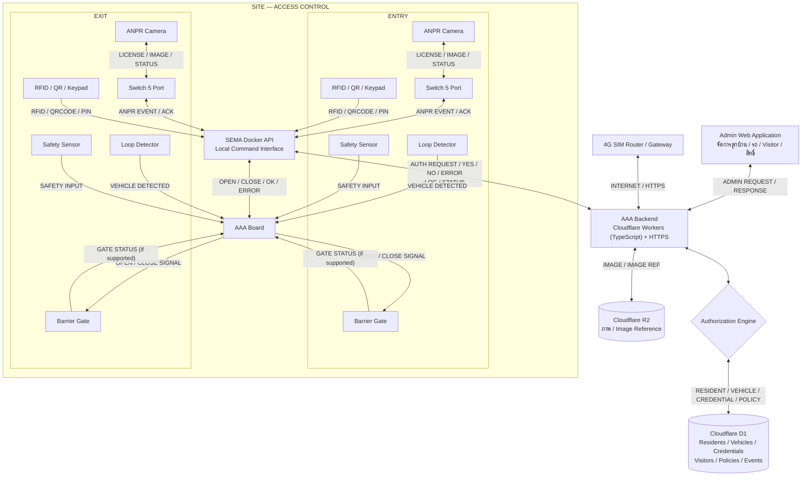

# AAA --- Axis Auto Access

## System Architecture & Development / Hardware Construction Brief

-   **เอกสาร:** `aaa-system-architecture.md`
-   **เวอร์ชัน:** 1.10 (Working Draft)
-   **วันที่:** 2026-11-12
-   **ชื่อ (2026-11-03):** SEMA Micro Controller / SEMA Board เปลี่ยนชื่อเป็น **AAA Board**
    (SEMA ยังเป็นผู้พัฒนาบอร์ดและ SEMA Docker)
-   **1.10:** authorize รับ `direction` (`ENTRY` / `EXIT`, ไม่บังคับ) บันทึกลง
    `tb_access_log.access_type` เพราะ SEMA ตัวเดียวคุมทั้งฝั่งเข้าและออก (§8.3, §8.4.1)
-   **1.9:** คำตอบ authorize มี `house_number` (บ้านเลขที่ของเจ้าของ input เมื่อ `YES`) (§8.4),
    migration `0003`; device ทดสอบ SEMA `SEMA-000-01`
-   **1.8:** โครงการทดสอบเปลี่ยนเป็น `PRJ-000` และล้างข้อมูลทดสอบ (beta) (§14 สถานะ Deploy)
-   **1.7:** Admin WebApp v1.3.0 ขึ้น Cloudflare Pages (`https://aaa-admin.pages.dev`)
    และตั้ง `ALLOWED_ORIGINS` แล้ว; บ้านที่ปิดใช้งานปฏิเสธลูกบ้านและ Visitor ของบ้านนั้น (§7)
-   **1.6:** Online-first: Whitelist ใช้เฉพาะตอน Internet ล่ม (§10); กล้อง ANPR
    Hikvision DS-TMC200-E1 ทำงานเมื่อ Loop Detector ส่งสัญญาณเข้า Alarm Input ของกล้อง (§5, §14 ข้อ 21)
-   **1.5:** สรุป concept ที่คุยกับ SEMA: AAA ตัดสินสิทธิ์ทั้งหมด, 1 บ้านมี
    "สิ่งที่ใช้เปิดได้" N รายการ, SEMA callback ผลการเปิด gate (§8.4.1)
    ใช้ชื่อเดิม `RFID` / `YES` (SEMA เรียก `CARD` / `PASS`)
-   **1.4:** ออกแบบการเก็บภาพที่ไม้กั้นใน R2 (§8.6) ยังไม่ได้พัฒนา
-   **1.3:** แยก repo: AAACLOUDF (เอกสาร), AAAAPI (Workers API แทน Go),
    AAASQL (D1 migrations แทน MS SQL), AAAADMIN (Admin WebApp), AAAAPP (LIFF)
-   **1.2:** Visitor / Guest Code (`<house_code>+xxxx` ใช้ได้ทั้ง QR และ Keypad),
    Owner API ผ่าน LINE LIFF, Admin WebApp บน Cloudflare Pages (CORS),
    Visitor งานส่วนกลาง, Audit Log และกันสุ่มรหัสที่ Keypad (§6, §7, §8, §12)
-   **1.1 (เพิ่มเติม):** Admin API จัดการบ้าน/ลูกบ้าน/รถ/บัตร/PIN (§8.1)
-   **1.1:** Backend เปลี่ยนจาก Golang เป็น TypeScript บน Cloudflare Workers +
    D1; API ตรวจสิทธิ์รวมเป็น endpoint เดียว (§8); เพิ่ม Data Model (§8.5);
    SEMA (Java Docker + Microcontroller ผ่าน SIM 4G/5G) ถือเป็น Blackbox
    รวมถึง Offline Mode และการควบคุมไม้กั้น
-   **สถานะ:** ใช้เป็นเอกสารตั้งต้นสำหรับ Software Development และ Hardware
    Construction
-   **ข้อสำคัญ:** รายการที่ระบุว่า "ต้องยืนยัน" เป็นข้อสมมติ/จุดรอข้อมูลจากผู้พัฒนา SEMA
    และทีมติดตั้ง ยังไม่ใช่ข้อกำหนดที่ยืนยันแล้ว

------------------------------------------------------------------------

## 1. วัตถุประสงค์ของระบบ

AAA (Axis Auto Access) เป็นระบบควบคุมการเข้า--ออกพื้นที่ด้วยการอ่านทะเบียนรถ
(ANPR) และ Credential เช่น RFID, QR Code และ PIN
โดยเชื่อมข้อมูลสิทธิ์จากระบบหลังบ้าน และควบคุมไม้กั้นผ่าน AAA Board

ระบบประกอบด้วย 2 ส่วนหลักที่พัฒนาคนละทีม:

1.  **AAA Backend --- ทีม Software:** พัฒนา REST API ด้วย TypeScript บน
    Cloudflare Workers + D1,
    ฐานข้อมูลลูกบ้าน/รถ/ผู้เยี่ยมชม, Authorization Policy และ Access Logs
2.  **SEMA Package --- ทีม Hardware/Embedded:** ส่งมอบ Docker/API
    สำหรับสื่อสารกับ AAA Board และควบคุมอุปกรณ์หน้างาน

ผู้ใช้ฝั่ง AAA มี 2 ช่องทาง:

-   **Admin WebApp (Cloudflare Pages):** นิติบุคคล/Admin จัดการบ้าน, ลูกบ้าน, รถ,
    บัตร/PIN, ค้างชำระ และ Visitor รวมถึงผู้เยี่ยมชมงานส่วนกลาง
-   **LINE LIFF (ลูกบ้าน/เจ้าของบ้าน):** ออก Guest Code ให้แขก / Rider / ผู้ส่งของ
    และเพิกถอนเองได้

## 2. ภาพรวมอุปกรณ์หน้างาน

### 2.1 ป้อม รปภ. / Network

-   Cloud Server: รัน AAA Backend และฐานข้อมูล หรือบริการที่เกี่ยวข้อง
-   4G SIM Router / Gateway: เชื่อมต่อไซต์กับ Internet/Cloud
-   ตู้ Access Control: ตำแหน่งติดตั้ง Controller/อุปกรณ์ประกอบตามแบบติดตั้งจริง

### 2.2 ฝั่งเข้า (Entry)

-   ANPR Camera: Hikvision DS-TMC200-E1
-   Ethernet Switch 5 Port
-   RFID / QR Code / Keypad Reader
-   Loop Detector สำหรับตรวจพบรถ
-   Barrier Gate
-   Safety Sensor / Loop สำหรับป้องกันไม้กั้นปิดใส่รถ
-   SEMA Docker API และ AAA Board ตามตำแหน่งติดตั้งที่ตกลงกัน

### 2.3 ฝั่งออก (Exit)

อุปกรณ์หลักตามแบบตัวอย่างคล้ายฝั่งเข้า ได้แก่ ANPR Camera, Switch, Reader, Loop
Detector, Barrier Gate และ Safety Sensor
ทั้งนี้ต้องยืนยันว่าฝั่งออกใช้การตรวจสอบสิทธิ์แบบใด และอุปกรณ์ใดเชื่อมต่อกับ Controller จริง

> **ข้อควรระวัง:** แผนผังที่มีอยู่เป็นภาพแนวคิดการติดตั้ง ยังไม่ใช่ Wiring Diagram
> ที่ยืนยันขั้วต่อ, Voltage, Protocol, Cable Type หรือ Pinout

------------------------------------------------------------------------

## 3. System Architecture



**หมายเหตุ:** Mermaid นี้เป็น Logical Architecture สำหรับคุยงาน
ไม่ได้ยืนยันว่าอุปกรณ์ทุกชิ้นเชื่อมตรงตามเส้นที่วาด ต้องปรับตามพอร์ตและ Protocol
ของอุปกรณ์จริง

------------------------------------------------------------------------

## 4. Data Labels ที่ใช้ในแผนภาพ

  Label                ความหมาย
  -------------------- --------------------------------------------
  `LICENSE`            หมายเลขทะเบียนรถที่อ่านได้
  `IMAGE`              ภาพจากกล้อง หรือภาพอ้างอิง
  `RFID`               Credential ID จาก RFID
  `QRCODE`             QR Token / Credential
  `PIN`                PIN ที่ผู้ใช้ป้อน --- ห้ามบันทึก PIN เป็นข้อความชัดเจน
  `AUTH REQUEST`       คำขอตรวจสอบสิทธิ์
  `YES`                อนุญาตให้เข้าออกตามนโยบาย
  `NO`                 ปฏิเสธการเข้าออก
  `ERROR`              ตรวจสอบไม่ได้หรือเกิดข้อผิดพลาด
  `OPEN` / `CLOSE`     คำสั่งควบคุมไม้กั้น
  `OK` / `ACK`         รับคำขอหรือคำสั่งแล้ว ไม่ได้แปลว่าไม้กั้นเปิดจริงเสมอไป
  `GATE STATUS`        สถานะไม้กั้นจริง หากมี Feedback Interface
  `VEHICLE DETECTED`   สัญญาณตรวจพบรถจาก Loop Detector
  `LOG`                ข้อมูลเหตุการณ์เข้าออก
  `STATUS`             สถานะอุปกรณ์/การเชื่อมต่อ
  `IMAGE REF`          ID หรือ URL อ้างอิงภาพใน Storage

------------------------------------------------------------------------

## 5. Flow หลัก: เข้าโดย ANPR

ลำดับด้านล่างเป็นลำดับเชิงตรรกะ ตัวตรวจจับรถและกล้องอาจทำงานคู่ขนานกัน

1.  Loop Detector ส่ง `VEHICLE DETECTED` เข้า Alarm Input ของกล้อง (สั่งกล้องโดยตรง ไม่ผ่าน AAA Board)
    และต่อเข้า AAA Board คู่กันเพื่อ Safety Interlock / ยืนยันว่ามีรถ (§14 ข้อ 21)
2.  ANPR Camera (Hikvision DS-TMC200-E1) จับภาพ อ่านทะเบียน แล้วส่ง `LICENSE` พร้อม `IMAGE`
    หรือ `IMAGE REF` ให้ SEMA
3.  SEMA Docker API ส่ง `AUTH REQUEST` ไป AAA Backend
4.  Backend ตอบ `YES`, `NO` หรือ `ERROR` พร้อมเหตุผลและ Event ID
5.  หาก `YES` และ Safety Conditions ผ่าน Docker/SEMA ส่ง `OPEN`
6.  AAA Board ควบคุม Relay/Output ตาม Interface ที่รองรับ
7.  Controller รายงาน `GATE STATUS` หากมี Feedback
8.  SEMA ส่ง `LOG`, ผลคำสั่ง และ `IMAGE REF` กลับ Backend
9.  Backend บันทึก Event และแสดงข้อมูลที่เกี่ยวข้องใน Admin

### ผลลัพธ์

-   `YES`: อนุญาตให้เปิดได้เมื่อ Safety Interlock ผ่าน
-   `NO`: ไม่เปิด และบันทึกเหตุผล
-   `ERROR`: ใช้ Offline Policy ที่กำหนดไว้ หรือปฏิเสธการเปิดอัตโนมัติ ห้ามตีความ
    Error เป็น Yes

## 6. Flow สำรอง: RFID / QR Code / PIN

1.  Reader อ่าน Credential
2.  SEMA ส่ง `RFID`, `QRCODE` หรือผลตรวจสอบ PIN ที่ปลอดภัยไปยัง Backend
    ตามรูปแบบที่ตกลง
3.  Backend ตรวจสอบ Credential, เจ้าของ, วันหมดอายุ, จำนวนครั้งที่ใช้ และ Policy
4.  Backend ส่ง `YES / NO / ERROR`
5.  เมื่อ `YES` และ Safety Conditions ผ่าน SEMA สั่ง `OPEN`
6.  ส่ง `GATE STATUS`, `LOG` และผลการทำงานกลับ Backend

### 6.1 Guest Code (Visitor / Rider / ผู้ส่งของ)

1.  ลูกบ้านออกโค้ดใน LINE LIFF เลือกอายุ 1 วัน / 7 วัน / 14 วัน / 30 วัน / 1 ปี /
    ตลอดไป (100 ปี) หรือ Admin ออกให้งานส่วนกลาง
2.  ได้โค้ดรูปแบบ `<house_code>+<สุ่ม 4 หลัก>` เช่น `9801+1234` (งานส่วนกลาง
    ขึ้นต้น `0+`) แชร์ให้แขกเป็น QR หรือเป็นตัวเลข
3.  แขกสแกน QR (`QRCODE` = `9801+1234`) หรือกด Keypad (`PIN` = `98011234`)
    ที่ไม้กั้น SEMA ส่งมาที่ `/api/v1/access/authorize` ตามปกติ
4.  Backend ตรวจโค้ด, ช่วงเวลา, สถานะเพิกถอน แล้วตอบ `YES / NO`
    พร้อมบันทึก `tb_access_log`
5.  ลูกบ้านเพิกถอนได้ทุกเมื่อ มีผลทันที

ข้อจำกัด: ส่วนสุ่มมีแค่ 4 หลัก (10,000 แบบต่อบ้าน) จึงมีกันสุ่มรหัส: อุปกรณ์ที่ส่ง
PIN/QR ผิดครบ 10 ครั้งใน 5 นาทีจะถูกปฏิเสธ PIN/QR ชั่วคราว (`TOO_MANY_ATTEMPTS`)

ข้อกำหนดความปลอดภัย: - ไม่บันทึก PIN หรือ Secret แบบ Plaintext - QR สำหรับ
Visitor ต้องมี Token ที่คาดเดาไม่ได้, ช่วงเวลาใช้งาน, สถานะเพิกถอน
และข้อจำกัดการใช้งานตาม Policy - การใช้ Credential
ออฟไลน์ต้องกำหนดว่ามีข้อมูลอะไรอยู่ใน Local Cache และตรวจสอบความหมดอายุได้อย่างไร

## 7. Access Policy เบื้องต้น

  ---------------------------------------------------------------------------------------------------
  กลุ่ม               ANPR                         RFID / QR / PIN          หมายเหตุ
  ----------------- ---------------------------- ------------------------ ---------------------------
  Resident สถานะปกติ อนุญาตเมื่อทะเบียนและ Policy ผ่าน อนุญาตตาม                 ต้องตรวจสอบสถานะลูกบ้านและรถ
                                                 Credential/Policy        

  Resident ค้างชำระ  ปฏิเสธ ANPR                   อนุญาตเฉพาะ RFID (บัตร)   ไม่ได้ห้ามเข้า แต่ไม่ได้
                                                 และ PIN (Keypad)         ความสะดวกของ ANPR; Response
                                                                          ส่ง `allowed_methods` บอกวิธีที่ใช้ได้

  Resident ค้างชำระ  ปฏิเสธ ANPR                   อนุญาตเฉพาะ PIN (Keypad)  ต้องลงมากด Keypad;
  ต่อเนื่อง                                                                   `payment_status = OVERDUE_SEVERE`

  Visitor           ปฏิเสธทะเบียนที่ไม่รู้จักโดยอัตโนมัติ   Guest Code ผ่าน QR       อนุญาตทะเบียน Visitor
                                                 หรือ Keypad ที่ยังไม่      อัตโนมัติได้เฉพาะเมื่อกำหนด
                                                 หมดอายุ/ไม่ถูกเพิกถอน      Policy ชัดเจน

  Credential        ปฏิเสธ                        ปฏิเสธ                    บันทึกเหตุผล
  หมดอายุ/ถูกเพิกถอน                                                         

  Cloud ตรวจสอบไม่ได้ ใช้ Offline Policy            ใช้ Offline Policy        หากไม่มีสิทธิ์ที่ยืนยันได้
                                                                          ไม่ควรเปิดอัตโนมัติ
  ---------------------------------------------------------------------------------------------------

บ้านที่ Admin ปิดใช้งาน (`tb_house.is_active = 0`) ปฏิเสธทุกวิธี: ลูกบ้านได้ `USER_INACTIVE`,
Visitor / Guest Code ของบ้านนั้นได้ `VISITOR_NOT_VALID` (ทะเบียน Visitor = `UNKNOWN_PLATE`)

## 8. API Contract ระหว่างทีม

Endpoint ที่ระบุ "พัฒนาแล้ว" มีอยู่ใน AAA Backend แล้ว (รายละเอียดใน `AAAAPI/README.md`)
ส่วนที่เหลือเป็น **ข้อเสนอสำหรับตกลงร่วมกัน**

### 8.1 AAA Backend --- Cloudflare Workers (TypeScript)

  ---------------------------------------------------------------------------------------
  Method                  Endpoint                                จุดประสงค์
  ----------------------- --------------------------------------- -----------------------
  `POST`                  `/api/v1/auth/device/token`             **พัฒนาแล้ว** แลก
                                                                  device secret เป็น JWT
                                                                  (HS256, อายุ 15 นาที)

  `POST`                  `/api/v1/access/authorize`              **พัฒนาแล้ว** ตรวจสิทธิ์
                                                                  ANPR / RFID / QRCODE /
                                                                  PIN ใน endpoint เดียว

  `POST`                  `/api/v1/admin/login`                   **พัฒนาแล้ว** Admin login
                                                                  (PBKDF2) → JWT 1 ชั่วโมง

  `*`                     `/api/v1/admin/houses`,                 **พัฒนาแล้ว** จัดการบ้าน
                          `/residents`, `/vehicles`,              (ค้างชำระ), ลูกบ้าน, รถ
                          `/credentials`, `/visitors`,            และบัตร/PIN, Visitor
                          `/residents/:id/link-code`              (รวมงานส่วนกลาง), รหัสผูก
                                                                  LINE แยกตามโครงการ
                                                                  (ดู AAAAPI README)

  `POST`                  `/api/v1/owner/link`,                   **พัฒนาแล้ว** ลูกบ้าน login
                          `/api/v1/owner/login`                   ด้วย LIFF ID Token
                                                                  → JWT 1 ชั่วโมง

  `*`                     `/api/v1/owner/me`,                     **พัฒนาแล้ว** ลูกบ้านออก /
                          `/api/v1/owner/visitors`                ดู / เพิกถอน Guest Code
                                                                  ของบ้านตัวเอง

  `POST`                  `/api/v1/access/events`                 ข้อเสนอ: รับ Command
                                                                  Result / Gate Status

  `POST`                  `/api/v1/devices/me/heartbeat`          รับสถานะอุปกรณ์

  `GET`                   `/api/v1/devices/me/sync`               ดึงข้อมูลสำหรับ Local Cache

  `GET`                   `/api/v1/devices/me/policies`           ดึง Policy
                                                                  ที่อุปกรณ์ได้รับอนุญาตให้ใช้
  ---------------------------------------------------------------------------------------

### 8.2 SEMA Docker API --- ตัวอย่าง Local API

  Method   Endpoint ตัวอย่าง         จุดประสงค์
  -------- ----------------------- -------------------------------
  `GET`    `/health`               ตรวจสอบว่า API ทำงาน
  `POST`   `/api/v1/gate/open`     สั่งเปิด
  `POST`   `/api/v1/gate/close`    สั่งปิด เมื่อปลอดภัยและได้รับอนุญาต
  `GET`    `/api/v1/gate/status`   อ่านสถานะ
  `POST`   `/api/v1/events`        ส่ง Event หากเป็นหน้าที่ของ Docker

### 8.3 ตัวอย่าง Authorization Request

Header `Authorization: Bearer <JWT>` --- `device_id` และ `project_id`
มาจาก Token ไม่รับจาก Body

``` json
{
  "event_id": "evt-unique-id",
  "method": "ANPR",
  "value": "กก9999",
  "direction": "ENTRY"
}
```

-   `direction` (ไม่บังคับ): `ENTRY` / `EXIT` ทิศของ event บันทึกลง `tb_access_log.access_type`
    ไม่ส่ง = ใช้ `tb_device.direction` ของอุปกรณ์; ค่าอื่น (รวมตัวพิมพ์เล็ก) = 400

### 8.4 ตัวอย่าง Authorization Response

``` json
{
  "event_id": "evt-unique-id",
  "decision": "NO",
  "house_number": null,
  "reason_code": "RESIDENT_OVERDUE",
  "allowed_methods": ["RFID"],
  "policy_version": 12
}
```

-   `house_number`: บ้านเลขที่ของเจ้าของ input ส่งเมื่อ `YES` (`NO` / Visitor งานส่วนกลาง = `null`)
    SEMA ใช้แค่ `decision` + `house_number` ก็พอ

-   `allowed_methods` บอกวิธีที่ผู้เข้ายังใช้ได้ เช่น ลูกบ้านค้างชำระเข้าด้วย ANPR
    ไม่ได้แต่แตะบัตร RFID ได้
-   `event_id` ซ้ำได้คำตอบเดิม (Idempotent)
-   `ERROR` ตอบ HTTP 500 ห้ามตีความเป็น `YES`

### 8.4.1 Concept ที่ตกลงกับ SEMA (2026-11-02)

**AAA ตัดสินสิทธิ์ (Online-first)** AAA Board ส่งสิ่งที่อ่านได้มาถาม
แล้วเปิด gate เมื่อได้ `YES` AAA Board ตัดสินเองจาก Whitelist ใน Local Cache
**เฉพาะเมื่อ Internet ล่มเท่านั้น** (ดู §10)

**1 บ้าน มี "สิ่งที่ใช้เปิดได้" N รายการ** เช่น บ้าน 98/6 (`house_code` = `9806`):

| ประเภท | `method` | ตัวอย่าง | เก็บที่ |
|---|---|---|---|
| บัตร RFID 2 ใบ | `RFID` | `X534D6` | `tb_credential` (HMAC) ของลูกบ้านในบ้าน |
| ทะเบียนรถ 3 คัน | `ANPR` | `กก9999` | `tb_vehicle` ของลูกบ้านในบ้าน |
| PIN 3 ชุด | `PIN` | `123456` | `tb_credential` (HMAC) |
| QR Code 2 ชุด | `QRCODE` | — | `tb_credential` (HMAC) |
| Guest Code | `QRCODE` / `PIN` | `9806+1234` | `tb_credential` ของ `tb_visitor` |

ทุกรายการผูกกับลูกบ้าน (`tb_user.house_id`) สิทธิ์คิดตาม `tb_house.payment_status`
ของบ้าน (§7) จึงจำกัด / ระงับทั้งบ้านได้ในที่เดียว

**ชื่อที่ใช้:** ใช้ชื่อเดิมของ AAA API ที่ deploy แล้ว SEMA ต้องส่ง / อ่านตามนี้

| SEMA เรียก | AAA API |
|---|---|
| `CARD` | `method: "RFID"` |
| `PASS` | `decision: "YES"` |
| user id (บ้าน) | `house_code` (`tb_user.user_id` คือลูกบ้านรายคน ไม่ใช่บ้าน) |

**Flow**

```
AAA Board                       AAA API (Workers)                D1
  | 1. อ่านบัตร / ทะเบียน / PIN / QR
  |-- POST /api/v1/access/authorize -->|
  |   { event_id, method: "RFID",      |-- หา credential -> ลูกบ้าน -> บ้าน
  |     value: "X534D6" }              |   ตรวจ active / หมดอายุ / policy ->|
  |<-- { decision: "YES", ... } -------|   บันทึก tb_access_log
  | 2. Safety ผ่าน -> สั่ง OPEN gate / barrier
  |-- POST /api/v1/access/events ----->|   (ข้อเสนอ ยังไม่พัฒนา)
  |   { event_id, result: "OPENED" }   |-- อัปเดต tb_access_log ของ event_id
```

1.  พัฒนาแล้ว: ขั้นที่ 1 (`/api/v1/access/authorize`) บ้านหาได้จากตัว credential เอง
    SEMA ไม่ต้องส่งรหัสบ้าน
2.  ข้อเสนอ: ขั้นที่ 2 callback ผลการเปิด gate ผ่าน `/api/v1/access/events`
    อ้าง `event_id` เดิม (Idempotent)
3.  พัฒนาแล้ว: `house_code` (ไม่บังคับ) เช่น `{ ..., "house_code": "9806" }` ใช้ตรวจซ้ำเท่านั้น
    ไม่ใช้ตัดสินสิทธิ์ credential ต้องเป็นของบ้านนั้น (ลูกบ้าน หรือ Visitor ของบ้าน)
    ไม่ตรง = `NO` + `HOUSE_MISMATCH`; Visitor งานส่วนกลาง / บ้านที่ไม่มี `house_code` ไม่ตรงเสมอ;
    รูปแบบผิด (`^[1-9]\d{0,5}$`) = 400; `HOUSE_MISMATCH` นับรวมในกันสุ่มรหัส PIN/QR (§6.1)
4.  พัฒนาแล้ว: `direction` (ไม่บังคับ) `ENTRY` / `EXIT` บอกว่า event มาจากฝั่งเข้าหรือออก
    เพราะ SEMA Docker ตัวเดียวคุมทั้งสองฝั่ง (1 device) ไม่ส่ง = ใช้ `tb_device.direction`

### 8.5 Data Model (Cloudflare D1)

Schema อยู่ใน repo AAASQL: `migrations/0001_init.sql` (v1.1.0) + `migrations/0002_visitor_owner.sql`
และ `migrations/0003_access_log_house_number.sql`

  Table             เก็บอะไร
  ----------------- ------------------------------------------------------------
  `tb_project`      โครงการ/หมู่บ้าน + `policy_version`
  `tb_house`        บ้านเลขที่ + `payment_status` (NORMAL / OVERDUE /
                    OVERDUE_SEVERE) + `house_code` (ตัวเลข ใช้นำหน้า Guest Code)
  `tb_user`         ลูกบ้าน + `line_user_id` (ผูก LINE LIFF), รหัสผูกบัญชี (hash)
  `tb_admin`        ผู้ดูแลระบบ (1 คน = 1 โครงการ) รหัสผ่านเก็บเป็น PBKDF2-SHA256
  `tb_vehicle`      รถของลูกบ้าน (ทะเบียนเก็บแบบไม่มีช่องว่างและ `-`)
  `tb_device`       อุปกรณ์ SEMA + `device_secret_hash`, `direction`, `last_seen`
  `tb_access_log`   ทุกการตัดสินสิทธิ์: `method`, `decision`, `reason_code`, `access_type` (ENTRY / EXIT),
                    `policy_version`, `credential_ref` (`log_id` = `event_id`),
                    `image_url` = key ภาพใน R2 (§8.6)
  `tb_blacklist`    ทะเบียนต้องห้าม
  `tb_visitor`      ผู้เยี่ยมชม + ช่วงเวลาที่อนุญาต, `purpose`, ผู้ออก (ADMIN/OWNER);
                    `house_id` NULL = งานส่วนกลาง
  `tb_credential`   RFID / QRCODE / PIN / GUEST เก็บเป็น HMAC-SHA256 เท่านั้น,
                    วันหมดอายุ, `max_uses`, สถานะเพิกถอน
  `tb_audit_log`    การกระทำของ Admin / Owner (ไม่มีรหัสผ่าน / credential)
  `tb_policy`       กลุ่ม (RESIDENT / RESIDENT_OVERDUE /
                    RESIDENT_OVERDUE_SEVERE / VISITOR) x วิธีเข้า;
                    ไม่มีแถว = ไม่อนุญาต

ยังต้องตกลงกับทีม SEMA: Timeout, Retry และ Versioning ของ API

### 8.6 ภาพที่ไม้กั้น (Cloudflare R2) --- ออกแบบแล้ว ยังไม่ได้พัฒนา

เก็บภาพรถจาก ANPR และภาพคนที่ใช้ QR / RFID / Keypad ทุก Event (ทั้ง `YES` และ `NO`)
ภาพเป็นข้อมูลส่วนบุคคลตาม PDPA (ทะเบียนรถ / ใบหน้า)

| หัวข้อ | ข้อกำหนด |
|---|---|
| Bucket | `aaa-images` (private, location hint APAC), binding `IMAGES` ใน Worker `aaa-api` ห้ามเปิด public / r2.dev |
| Key | `<project_id>/<YYYY-MM-DD>/<event_id>.jpg` (วันที่ UTC) เก็บใน `tb_access_log.image_url` ห้ามเก็บภาพใน D1 |
| ผู้อัปโหลด | SEMA ส่งภาพมาที่ AAAAPI (ไม่ใช้ presigned URL, ไม่มี R2 key ที่ไซต์) |
| Retention | 90 วัน ลบอัตโนมัติด้วย R2 Lifecycle Rule ทั้ง bucket |
| ผู้ดูภาพ | Admin ของโครงการนั้น และลูกบ้านเฉพาะ Event ที่ผูกกับบ้านตัวเอง |

**อัปโหลด:** `PUT /api/v1/access/events/:event_id/image` (Device JWT)

-   Body = ไฟล์ภาพดิบ `Content-Type: image/jpeg` ไม่เกิน 2 MB (เกิน → `413`, type อื่น → `415`)
-   ส่ง **หลัง** ได้คำตอบ `/access/authorize` แล้ว ไม่หน่วงการเปิดไม้กั้น
-   ต้องมี `tb_access_log` ที่ `log_id = event_id`, `project_id` และ `device_id` ตรงกับ Token ไม่งั้น `404`
    (SEMA retry ได้ เช่นกรณีภาพมาถึงก่อน log)
-   Worker เขียน R2 แล้ว `UPDATE tb_access_log SET image_url = <key>`; ส่งซ้ำ = เขียนทับ key เดิม (Idempotent)
-   Offline: SEMA เก็บภาพไว้ใน Local Queue คู่กับ Event แล้วส่งตามเมื่อกลับมา Online

**ดูภาพ:** Worker อ่านจาก R2 แล้วส่งต่อ (`Cache-Control: private, no-store`) ไม่คืน URL ของ R2

| Method | Endpoint | สิทธิ์ |
|---|---|---|
| `GET` | `/api/v1/admin/access-logs` | Admin: รายการ log ของโครงการ (`?from=&to=&license_plate=`) |
| `GET` | `/api/v1/admin/access-logs/:log_id/image` | Admin: ภาพของ log ในโครงการตัวเอง |
| `GET` | `/api/v1/owner/access-logs` | ลูกบ้าน: log ที่ `house_id` = บ้านตัวเอง |
| `GET` | `/api/v1/owner/access-logs/:log_id/image` | ลูกบ้าน: ภาพของ log บ้านตัวเองเท่านั้น |

-   ภาพหมดอายุแล้ว (R2 ลบแล้ว แต่ `image_url` ยังอยู่) → `404 IMAGE_EXPIRED`
-   ทุกการดูภาพบันทึกใน `tb_audit_log` (`action` = `GET <route>`, `target_id` = `log_id`)

**Schema (AAASQL migration ใหม่):** เพิ่ม `tb_access_log.house_id` (NULL ได้) + index `(house_id, timestamp)`
ใส่ตอนตัดสินสิทธิ์: ลูกบ้าน = บ้านของลูกบ้าน, Visitor = `tb_visitor.house_id`;
ทะเบียนไม่รู้จัก / Visitor งานส่วนกลาง = NULL (ลูกบ้านไม่เห็น)

ข้อควรระวัง: ลูกบ้านจะเห็นภาพแขก / Rider ที่เข้ามาหาบ้านตัวเอง ต้องแจ้งในประกาศความเป็นส่วนตัว (PDPA)

## 9. Authentication และ Network Security

-   ใช้ HTTPS ที่ตรวจสอบ TLS Certificate อย่างถูกต้อง
-   หากใช้ JWT ให้กำหนด `iss`, `aud`, `exp`, `sub`, `scope` และอายุ Token
-   อุปกรณ์แต่ละตัวควรมี Identity/Credential ของตัวเอง
    สามารถปิดใช้งานหรือเพิกถอนได้
-   ไม่ฝัง Long-lived Secret หรือ Private Signing Key ของ Backend ลงใน
    Image ที่แจกทั่วไป
-   จำกัดสิทธิ์ API ตาม Device และ Site
-   ใช้ Rate Limiting, Request Validation, Audit Logs และ Idempotency Key
    สำหรับคำสั่งที่อาจถูกส่งซ้ำ
-   Local Docker API ไม่ควรเปิดสู่ Public Internet โดยตรง ควรจำกัดวง LAN
    และตรวจสอบผู้เรียก
-   ห้ามให้คำตอบจาก Backend เพียงอย่างเดียวข้าม Safety Interlock ของ
    AAA Board

## 10. Offline Mode

ต้องกำหนดและทดสอบกรณี Router/SIM, Internet หรือ Cloud ใช้งานไม่ได้

**หลัก (ตกลง 2026-11-03): Online-first, Whitelist เป็นทางสำรองเมื่อ Internet ล่มเท่านั้น**

| สิ่งที่เกิดกับ `/api/v1/access/authorize` | AAA Board ทำอะไร |
|---|---|
| ได้ `YES` | เปิด gate |
| ได้ `NO` | ไม่เปิด **ห้ามใช้ Whitelist ข้ามคำตอบ `NO`** (เช่น ค้างชำระ, เพิกถอน, `HOUSE_MISMATCH`) |
| เชื่อมต่อไม่ได้ / ไม่ตอบภายใน Timeout / ขอ Device Token ใหม่ไม่ได้ | ถือว่า Internet ล่ม → ตัดสินจาก Whitelist ตาม Offline Policy |
| ได้ `ERROR` (HTTP 5xx) | ข้อเสนอ: ถือเป็น Cloud ล่ม → ใช้ Whitelist ได้ ห้ามแปลง `ERROR` เป็น `YES` ตรง ๆ (รอยืนยัน §14 ข้อ 20) |

-   ทุกการตัดสินแบบ Offline ต้องเก็บใน Local Queue พร้อม flag `offline`
    แล้วส่งขึ้น `/api/v1/access/events` เมื่อกลับมา Online
-   Whitelist ไม่ถูกใช้ตอน Online จึงไม่กระทบการเพิกถอน / ค้างชำระที่มีผลทันที
    ความเสี่ยงเหลือเฉพาะช่วงที่ Internet ล่ม (สิทธิ์ที่เพิ่งเพิกถอนแต่ยังไม่ sync)
-   SEMA/Local Service ใช้ Local Cache ได้เฉพาะข้อมูลและ Policy
    ที่ซิงก์ไว้ตามข้อกำหนด
-   Cache ต้องมี `policy_version`, เวลา Sync ล่าสุด และวันหมดอายุของ
    Credential
-   ระบุวิธีจัดการสิทธิ์ที่เพิ่งถูกเพิกถอนแต่ยังไม่ถึงไซต์
-   กำหนดชัดเจนว่าการเข้าออกประเภทใดทำงาน Offline ได้ และประเภทใดต้อง Online
-   เมื่อไม่สามารถยืนยันสิทธิ์ได้ ให้ใช้ Policy ที่ตกลงไว้ ห้ามเปลี่ยน `ERROR` เป็น `YES`
    โดยอัตโนมัติ
-   เก็บ Event ไว้ใน Local Queue แล้วส่งขึ้น Backend เมื่อกลับมา Online โดยป้องกัน
    Event ซ้ำ

## 11. Hardware Construction และ Safety

ทีมก่อสร้าง/ติดตั้งต้องจัดทำ Wiring Diagram แยกจาก Logical Architecture โดยระบุ:

-   รุ่นอุปกรณ์, จำนวน, ตำแหน่ง และหมายเลขอุปกรณ์
-   IP Address / Subnet / VLAN (ถ้ามี) และ Port Mapping ของ Switch
-   ชนิดสาย, ระยะสาย, แหล่งจ่ายไฟ, Voltage/Current และการป้องกันไฟฟ้า
-   Interface จริงของ ANPR, Reader, Loop Detector, Safety Sensor, SEMA
    และ Gate Controller
-   Relay Contact Type, Input/Output Voltage, Pinout และ Isolation
-   วิธีตรวจสอบสถานะเปิด/ปิดไม้กั้นจริง
-   Safety Interlock ต้องไม่ให้ไม้กั้นปิดเมื่อมีรถหรือสิ่งกีดขวางตามการออกแบบของผู้ผลิต
-   การติดตั้งต้องทำตามคู่มือผู้ผลิตและให้ช่างผู้มีคุณสมบัติตรวจสอบวงจรไฟฟ้า

> ห้ามต่อแรงดันไฟฟ้าเข้าขา AAA Board/Relay โดยอาศัยการคาดเดาจากภาพ
> ต้องตรวจสอบ Datasheet และ Wiring Diagram ของรุ่นจริงก่อน

## 12. Logging และ Audit

ทุก Access Event ควรมีอย่างน้อย:

-   `event_id` และ `session_id`
-   `site_id` และ `device_id`
-   เวลาเกิดเหตุและเวลาที่ Backend รับข้อมูล
-   วิธีเข้า: `ANPR`, `RFID`, `QRCODE`, `PIN`
-   ทะเบียนหรือ Credential Reference ตามความเหมาะสม
-   ผล `YES / NO / ERROR` และ `reason_code`
-   `policy_version` และสถานะ Online/Offline
-   `image_ref` หากมีภาพ
-   `command_id`, Command Result และ Gate Status หากอุปกรณ์รองรับ

ห้ามบันทึก PIN, JWT, Device Secret หรือข้อมูลลับลง Log แบบ Plaintext

การกระทำของ Admin และลูกบ้าน (สร้าง/แก้/ลบ, login, ผูก LINE, ออก/เพิกถอน Guest Code)
บันทึกใน `tb_audit_log` พร้อมผู้กระทำและเป้าหมาย โดยตัดค่าลับออก

## 13. Test / Acceptance Checklist

### Software

-   [ ] ตรวจสอบทะเบียนที่มีสิทธิ์และไม่มีสิทธิ์
-   [ ] ทดสอบ Resident ค้างชำระ: ANPR ถูกปฏิเสธ แต่ RFID และ PIN เข้าได้
-   [ ] ทดสอบ Resident ค้างชำระต่อเนื่อง: ANPR และ RFID ถูกปฏิเสธ เหลือ PIN
-   [ ] ทดสอบ Visitor QR ที่ถูกต้อง, หมดอายุ, ใช้แล้ว, ถูกเพิกถอน และอยู่นอกช่วงเวลา
-   [ ] ทดสอบ `YES / NO / ERROR`, Timeout และ API ไม่พร้อมใช้งาน
-   [ ] ทดสอบ JWT หมดอายุ, Token ถูกเพิกถอน และ Device ที่ไม่รู้จัก
-   [ ] ทดสอบ Event ซ้ำ, Request ซ้ำ และการ Sync หลัง Offline
-   [ ] ตรวจสอบว่า Log ไม่มี PIN/Secret
-   [ ] Admin โครงการหนึ่งอ่าน/แก้ข้อมูลของอีกโครงการไม่ได้ และ Device Token
    ใช้เรียก Admin API ไม่ได้
-   [ ] Admin API ไม่คืนค่าจริงหรือ hash ของ RFID / QR / PIN
-   [ ] Guest Code ใช้ได้ทั้ง QR และ Keypad, หมดอายุตามระยะที่เลือก, เพิกถอนแล้วใช้ไม่ได้
-   [ ] ลูกบ้านเห็น/เพิกถอนได้เฉพาะ Visitor ของบ้านตัวเอง
-   [ ] กดรหัสผิดซ้ำที่ Keypad ถูกล็อก PIN/QR ชั่วคราว แต่ ANPR/RFID ยังใช้ได้
-   [ ] Audit Log ครบทุกการแก้ไข และไม่มีค่าลับ

### Hardware / Site

-   [ ] ตรวจสอบ Link ของ Router และ Switch
-   [ ] ตรวจสอบว่า ANPR ส่งทะเบียน/ภาพหรือ Event ได้จริง
-   [ ] ตรวจสอบ Reader Interface และข้อมูลที่อ่านได้
-   [ ] ตรวจสอบ Loop Detector และสัญญาณ Input
-   [ ] ตรวจสอบคำสั่งเปิด/ปิดและสถานะ Gate Feedback
-   [ ] ทดสอบ Safety Sensor และการป้องกันไม้กั้นปิดใส่รถ
-   [ ] ทดสอบไฟดับ, Network หลุด และการกลับมาทำงาน
-   [ ] ยืนยัน Wiring Diagram กับรุ่นอุปกรณ์จริงก่อนเปิดใช้งาน

## 14. Open Decisions --- ต้องยืนยันกับทีม

1.  Docker รันบน Edge Computer/Linux Host หรืออุปกรณ์ประเภทใด และใครเป็นผู้ดูแล
    Deployment/Update
2.  SEMA Docker API และ AAA Board สื่อสารกันด้วย Protocol ใด
3.  กล้อง ANPR ส่ง Event ผ่าน HTTP/ISAPI, SDK หรือ I/O
4.  Reader ใช้ Wiegand, RS-485, USB, Ethernet หรือ Interface อื่น
5.  Loop Detector/Safety Sensor ใช้ Relay Contact หรือ Digital Input แบบใด
6.  ใครเป็นผู้เรียก Backend และใครเป็นผู้ส่ง Access Event (ภาพ: SEMA ส่งมาที่ AAAAPI ตาม §8.6)
7.  API Contract ฉบับจริง: Endpoint, JSON Schema, Auth, Error Code,
    Timeout, Retry และ Version
8.  Offline Policy (ใครเข้าได้ด้วยวิธีไหนตอน Internet ล่ม), Cache TTL, รอบ Sync
    และการเพิกถอนสิทธิ์ (หลัก Online-first ตกลงแล้ว §10)
9.  วิธีรับสถานะ Gate จริงและการจัดการเมื่อ Command สำเร็จแต่ Gate ไม่เปิด
10. Network Topology จริง, IP Plan, VLAN, Firewall และตำแหน่ง
    Router/Switch
11. ภาพ: ตกลงแล้ว (§8.6) เหลือยืนยันกับทีม SEMA ว่ากล้อง / Reader ส่งภาพ JPEG ได้และขนาดไม่เกิน 2 MB
12. เกณฑ์เลื่อนระดับค้างชำระ (NORMAL → OVERDUE → OVERDUE_SEVERE): จำนวนวัน
    และใครเป็นผู้แก้ `payment_status` (ตอนนี้ Admin/ระบบบิลแก้เอง)
13. (Idea) แจ้งเตือน LINE ถึงเจ้าของบ้านเมื่อ ANPR ถูกปฏิเสธเพราะค้างชำระ:
    LINE `userId` เก็บแล้วใน `tb_user.line_user_id` (จากการผูกบัญชีผ่าน LIFF)
    เหลือ: ใช้ Messaging API ของ LINE OA ที่ LIFF อยู่, จำกัดไม่เกิน
    1 ครั้ง/บ้าน/วัน และส่งแบบ async ไม่ให้หน่วงการตอบ SEMA
14. Rate Limit ที่ `/api/v1/admin/login`, `/api/v1/owner/*` และ
    `/api/v1/auth/device/token`: ตอนนี้ deploy บน `workers.dev` ซึ่งตั้ง WAF ไม่ได้
    ต้องใช้ Workers Rate Limiting binding (นับต่อ location, ประมาณการ) หรือย้ายไป
    โดเมนของตัวเองแล้วใช้ WAF; และ API สำหรับ Policy / Blacklist / Device /
    เปลี่ยนรหัสผ่าน Admin ที่ยังไม่ได้ทำ
15. Guest Code: ส่วนสุ่ม 4 หลักตามที่กำหนด คาดเดาได้ง่ายกว่า QR แบบสุ่มยาว
    ยืนยันว่ายอมรับความเสี่ยงนี้ และเกณฑ์ล็อก (10 ครั้ง / 5 นาที / อุปกรณ์)
    ลูกบ้านค้างชำระยังออก Guest Code ได้หรือไม่ (ตอนนี้ได้)
16. Admin WebApp ขึ้น Pages แล้ว (`https://aaa-admin.pages.dev` อยู่ใน `ALLOWED_ORIGINS`);
    LIFF app ยังไม่ได้พัฒนา ต้องเพิ่ม origin ของ LIFF ใน `ALLOWED_ORIGINS`
    และสร้าง LINE Login channel + LIFF เพื่อได้ `LINE_CHANNEL_ID`
17. (§8.4.1) API รับ `house_code` เพื่อตรวจซ้ำแล้ว (ไม่บังคับ) เหลือยืนยันกับ SEMA ว่าจะส่ง
    ทุกครั้งหรือเฉพาะ PIN ที่กด `#เลขที่บ้าน#` ก่อน และให้ใส่ `house_code` ในคำตอบหรือไม่
18. (§8.4.1) ค่าตัวที่ 4 ที่ SEMA เสนอ (`"OK"` ใน `RightChecker("9806","CARD","X534D6","OK")`)
    หมายถึงอะไร เช่น สถานะการอ่านของ Reader หรือ Loop Detector ตรวจพบรถ
19. (§8.4.1) แยกเปิด Auto Gate (ประตูบานเลื่อน) กับ Barrier อย่างไร:
    1 device ต่อ 1 จุด หรือส่งเป้าหมายมาใน request; และ Schema ของ callback
    `/api/v1/access/events` (`result`, เวลา, Gate Status)
20. (§10) ค่า Timeout ก่อนถือว่า Internet ล่ม และได้ `ERROR` (HTTP 5xx) จาก Backend
    ให้ใช้ Whitelist ได้หรือต้องปฏิเสธ
21. (§5) ใครสั่งกล้อง ANPR ทำงานหลังรถเหยียบ Loop: **ตกลงแล้ว** Loop Detector ต่อเข้า
    Alarm Input ของ Hikvision DS-TMC200-E1 ให้กล้องจับภาพเอง (เป็นงานของ SEMA ไม่ใช่ AAA)
    เหลือยืนยันกับ SEMA / ทีมติดตั้ง:
    -   ~~DS-TMC200-E1 มี Alarm Input~~ ยืนยันแล้วจาก Datasheet
        (`AAADATASHEET/DS-TMC200-E1_Datasheet_20251209.pdf`, ตรงกับฉบับ 20250331):
        Alarm Input 2-ch triggered inputs, Trigger Type "Video Detection, I/O Coil, Radar Mixed Traffic",
        Alarm Output 1-ch, Relay Output 1-ch, RS485, 1 RJ45 100M, API ISAPI / SDK / ISUP;
        Power AC 100–240V; ความแม่นยำ (ฉบับ 20250331) LPR > 98%
        (98.5% คือความแม่นยำทิศทางรถ ไม่ใช่การอ่านทะเบียน)
        เหลือตรวจรุ่นที่ซื้อจริง (`/3106` ไฟขาว หรือ `(I)/3106` IR) และวิธีต่อสายจากคู่มือติดตั้ง
    -   Output ของ Loop Detector (Relay Contact / Dry Contact) ต่อเข้า Alarm Input ได้ตรง
        และต้องแยกสัญญาณ (Isolation / Relay ตัวที่ 2) ไปเข้า AAA Board ด้วยหรือไม่
    -   กล้องส่งผลทะเบียน + ภาพให้ SEMA Docker ผ่านช่องทางใด (ISAPI HTTP Push / SDK) (ข้อ 3)
    -   ถ้า Loop ทำงานแต่อ่านทะเบียนไม่ได้ SEMA ทำอะไร (ให้ใช้ RFID / PIN แทน)

**สถานะ Deploy (2026-11-12, beta):** AAA Backend ขึ้น production แล้วที่
`https://aaa-api.cookievirus.workers.dev` ใช้ D1 `db1-aaa` (APAC), Admin WebApp ที่
`https://aaa-admin.pages.dev`; โครงการทดสอบ `PRJ-000` (เดิม `PRJ-001`) และ Admin คนแรก
ข้อมูลทดสอบล้างแล้ว 2026-11-12; ฐานข้อมูลเก่า `d1-db-aaa` (schema v1.0 ว่าง) ลบแล้ว

## 15. เอกสารส่งมอบที่ควรแยกกัน

-   `aaa-system-architecture.md` --- เอกสารนี้: Logical Architecture, Data
    Flow และข้อกำหนดตั้งต้น
-   `aaa-api-contract.md` --- Endpoint, Request/Response Schema,
    Authentication และ Error Codes
-   `aaa-site-network-plan.md` --- IP Plan, Switch Port Mapping, VLAN,
    Router และ Firewall
-   `aaa-hardware-wiring.md` --- Wiring Diagram, Pinout, Voltage, Relay
    และ Sensor
-   `aaa-test-acceptance.md` --- Test Cases และเกณฑ์รับมอบ

------------------------------------------------------------------------

**สถานะเอกสาร:** Working Draft --- ใช้เริ่มวางแผนและแบ่งงานได้ แต่ต้องปิด Open
Decisions และยืนยัน Datasheet/API จากทีมที่เกี่ยวข้องก่อนใช้เป็นแบบก่อสร้างหรือ
Production Contract
